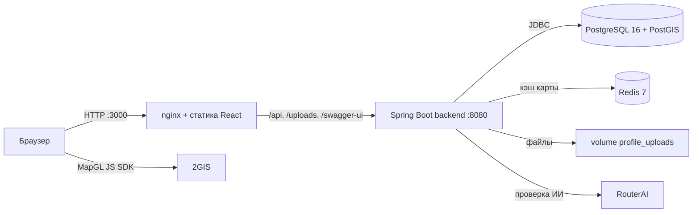
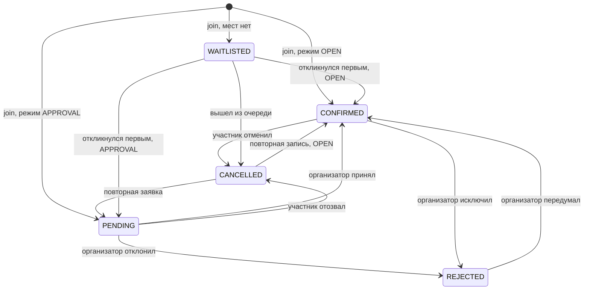

# Архитектура

## Принципы

- **API-first.** Вся бизнес-логика и проверка прав — на Java-бэкенде; веб-клиент — один из потребителей REST API. Тот же API подходит мобильному приложению.
- **Данные вместо кода.** Формат мероприятия (поля, вопросы участнику, значения по умолчанию) задаётся JSON-схемой в таблице `event_templates`.
- **Package-by-feature.** Каждый модуль (`event`, `participation`, `recommendation`…) содержит свои `controller / service / repository / model / dto`; связи между модулями идут через сервисы и доменные события.
- **Масштаб страны с первого дня.** Геопоиск на PostGIS с GiST-индексом, местное время площадки, ограниченные выборки, расчёты в фоне.
- **Объяснимость.** Рекомендация приходит с причинами и вкладом каждого признака.
- **Предсказуемые ошибки.** Единый формат `{"error": {"code", "message"}}`.

## Компоненты и развёртывание

Четыре контейнера в `docker-compose.yml`:

| Сервис | Образ | Роль |
|--------|-------|------|
| `postgres` | `postgis/postgis:16-3.4-alpine` | Данные, геоиндекс, материализованные представления |
| `redis` | `redis:7-alpine` | Только кэш: без сохранения на диск, память 128 МБ, вытеснение `allkeys-lru` |
| `backend` | сборка `backend/Dockerfile` (Maven → JRE 21) | REST API, JWT, фоновые задачи, раздача `/uploads/**` |
| `frontend` | сборка `frontend/Dockerfile` (Node → nginx) | SPA и reverse-proxy к бэкенду |

Миграции схемы выполняет Flyway при старте бэкенда. Hibernate работает в режиме `ddl-auto: validate` и схему не меняет. Включён `out-of-order`, чтобы миграция, пришедшая из слияния ветки позже уже применённой, выполнялась на существующих базах; на чистой базе порядок обычный.

## Модули backend

Пакет `ru.sportikus`:

| Модуль | Ответственность |
|--------|-----------------|
| `auth`, `security` | Вход, регистрация пользователя и организации, JWT (`JwtService`, `JwtAuthFilter`), `CurrentUser` |
| `user` | Пользователи, публичные профили, загрузка фото, личный кабинет (`/me/*`) |
| `organization` | Организации и статусы `PENDING → APPROVED / REJECTED`, реквизиты ИНН, ОГРН, КПП |
| `sport` | Справочник видов спорта; новый вид нормализуется в slug (`SlugUtil`) |
| `template`, `form` | Конструктор: шаблоны, описание полей (`FieldDef`), универсальный валидатор (`FieldValidator`) |
| `event` | Мероприятия, каталог с фильтрами и геопоиском, повторяющиеся занятия, завершение и архив, экспорт `.ics`, кэш карты (`event.cache`) |
| `participation` | Запись и заявки, очередь на места, решения организатора, блокировка мест, билеты, отметка на входе, CSV-экспорт участников |
| `comment` | Обсуждение: сообщения, значок организатора, мягкое скрытие |
| `friendship` | Заявки в друзья, принятие, поиск по e-mail, «Идут друзья» на карточке |
| `subscription` | Подписки пользователей на одобренные организации |
| `notification` | Центр уведомлений, приглашения друзей на мероприятия, напоминания за сутки (`notification.jobs`) |
| `stats` | Публичная сводка платформы для приветственной страницы (`GET /public/stats`) |
| `achievement` | 30 достижений по метрикам активности, считаются запросом при обращении |
| `moderation` | Автопроверка мероприятий: фильтр запрещённых тем, проверка ИИ через RouterAI |
| `admin` | Модерация организаций и снятие мероприятий с публикации |
| `city` | Справочник городов, ближайший город к точке, часовые пояса |
| `preference` | Интересы и предпочтения пользователя |
| `recommendation` | Источники кандидатов, ранжирование, сигналы, кэш, журнал, фоновые задачи |
| `common`, `config` | `ApiException`, обработчик ошибок, Security, OpenAPI, планировщик, раздача файлов |

## Ключевые потоки

### Публикация мероприятия

1. Клиент загружает шаблоны (`GET /templates`), пользователь выбирает формат и заполняет поля.
2. `POST /events`: проверяется роль (администратор не создаёт), для организации — статус `APPROVED` (иначе `403`) и обязательные контакты; значения полей валидируются по схеме шаблона, вопросы участнику — по определениям.
3. Вид спорта находится по id или создаётся по названию (slug), по координатам определяются ближайший город и часовой пояс, поля шаблона копируются в событие снимком.
4. Автопроверка: чистое мероприятие публикуется сразу, сомнительное — после решения ИИ. Ручной премодерации нет. См. [Автопроверка](moderation.md).
5. После фиксации транзакции сбрасывается кэш карты.

### Участие с подтверждением

Все операции с местами выполняются под `SELECT … FOR UPDATE` на строке мероприятия: последнее место нельзя выдать дважды. Проверяются собственное мероприятие, снятие с публикации, завершение, закрытая регистрация, повторные заявки, лимит мест, обязательные ответы анкеты и подтверждение требований. Каждое изменение статуса публикует `ParticipationChangedEvent`, на который подписана рекомендательная система.

### Очередь на места

Когда мест нет (или уже кто-то стоит в очереди), запись получает статус `WAITLISTED` и места не занимает. Если подтверждённый участник отменяет запись или организатор его исключает, все ожидающие получают уведомление `WAITLIST_SPOT_AVAILABLE`, а место достаётся первому, кто повторит `POST /events/{id}/join`: под блокировкой строки мероприятия он становится `CONFIRMED` (или `PENDING` при режиме `APPROVAL`), остальным уходит `WAITLIST_SPOT_TAKEN`. Таймеров нет — неактивный человек очередь не задерживает. Организатор не может подтвердить заявку из очереди: место занимает сам участник. Число стоящих в очереди — `waitlistCount` в карточке мероприятия.

### Билеты и отметка на входе

Когда участие становится `CONFIRMED` (сразу при `OPEN` или после решения организатора), сервис выдаёт код билета `SPT-` и восемь символов случайного UUID в верхнем регистре. Код уникален (`UNIQUE` в `participations.ticket_code`). Клиент строит QR-код библиотекой `qrcode`.

`POST /events/{eventId}/checkin` с телом `{"ticketCode": "…"}` доступен организатору мероприятия и администратору. Код приводится к верхнему регистру и проверяется последовательно:

| Статус | Когда |
|--------|-------|
| `NOT_FOUND` | Код пустой или билета нет в системе |
| `WRONG_EVENT` | Билет принадлежит другому мероприятию |
| `NOT_CONFIRMED` | Участие не в статусе `CONFIRMED` |
| `ALREADY_CHECKED_IN` | Билет уже использован (возвращается время первой отметки) |
| `SUCCESS` | Участник допущен: сохраняются `checked_in`, время и кто отметил |

Ответ содержит участника, название мероприятия, признак платного входа и цену — организатор видит, нужно ли брать оплату.

**Сканер на клиенте** (`CheckInScannerModal`, библиотека `html5-qrcode`) открывается на весь экран (портал в `document.body`) и даёт три способа отметить вход:

| Способ | Когда работает |
|--------|----------------|
| Живая камера | Только на защищённой странице: `https://` или `localhost`. По `http://` браузер не даёт доступ к камере и даже не спрашивает разрешение |
| «Сфотографировать QR» | Всегда, в том числе по `http://`: системная камера телефона делает снимок, QR распознаётся с картинки |
| Ввод кода вручную | Всегда |

Сканер заранее проверяет `window.isSecureContext` и наличие `getUserMedia` и сразу объясняет, почему камеры нет. Ошибки запуска различаются: запрет доступа (с подсказкой, где разрешить камеру на iPhone и Android), камера не найдена, камера занята другим приложением. Пока QR в кадре, камера распознаёт его много раз в секунду, поэтому повтор того же кода в течение 15 секунд игнорируется — иначе успешную отметку сразу сменило бы «Билет уже использован». Код билета извлекается из содержимого QR по шаблону `SPT-XXXXXXXX`. Поверх камеры лежит рамка наведения; есть **фонарик** (включается, если устройство поддерживает режим `torch`), счётчик «Отмечено на мероприятии» (уже отмеченные из подтверждённых) и карточка результата с именем и фото участника, признаком платного входа и ценой.

Код билета постоянный, а вход по нему одноразовый: первое сканирование ставит отметку, повторное отвечает `ALREADY_CHECKED_IN` со временем первого входа. Пересланный скриншот QR пропустит того, кто придёт первым, поэтому при сканировании показываются имя и аватар участника.

### Завершение, архив и повторы

`POST /events/{id}/complete` переводит мероприятие в `ARCHIVED`. Условия: вызывает организатор, время окончания прошло, статус `PUBLISHED`; повторное завершение и завершение снятого или отменённого мероприятия отвечают `409`. Архив организатора и подтверждённых участников показывается в «Моих событиях». Каталог и карта показывают только опубликованные мероприятия, поэтому архивные из них исчезают.

**Повторяющиеся мероприятия.** При создании задаётся `recurrenceRule`: `NONE` (по умолчанию), `WEEKLY` (интервал 7 дней) или `CUSTOM` с `recurrenceIntervalDays` от 1 до 365 (без интервала — `400`). У повторяющегося события сразу появляется `recurrence_series_id`. Следующее занятие создаётся в момент завершения текущего (`EventService.nextOccurrence`): сервис копирует поля, анкету, цену, лимит, сведения организации и результат автопроверки, сдвигает начало на интервал **по местному времени площадки** (поэтому «вечер» остаётся вечером при переходе на летнее время) и повторяет сдвиг, пока начало не окажется в будущем; крайний срок записи сдвигается на тот же промежуток. Новое занятие публикуется сразу со статусом `PUBLISHED`, а ссылка на него записывается в `next_occurrence_id` завершённого (`nextOccurrenceId` в API). Участники и заявки не переносятся. Расписание наперёд не строится: следующее занятие появляется только по завершении предыдущего.

### Обсуждение под мероприятием

Таблица `comments` (`text`, `is_organizer`, `is_hidden`). Читать обсуждение можно без входа, писать — после входа (до 2000 символов). Признак `is_organizer` выставляет сервис: автор мероприятия или владелец организации получают значок «Организатор». Скрытие мягкое: `CommentDto` подменяет текст заглушкой «Сообщение скрыто модератором» для всех, кроме администратора. Скрыть может администратор, автор сообщения и организатор мероприятия. Клиент обновляет обсуждение опросом раз в 8 секунд.

### Дружба, подписки, достижения

- **Дружба.** Одна строка в `friendships` на пару пользователей независимо от того, кто отправил заявку (уникальный индекс по `LEAST/GREATEST`). Статусы `PENDING` и `ACCEPTED`. Нельзя дружить с собой и с администратором; встречная заявка требует принять или отклонить входящую. Поиск — по точному e-mail, без администраторов. «Идут друзья» подмешивается в ответ для каждого просматривающего пользователя отдельно, поэтому в кэш карты не попадает.
- **Подписки.** Подписаться можно только на одобренную организацию, не на собственную; повторная подписка ничего не меняет.
- **Достижения.** Метрики считаются SQL-запросами по участиям, дружбе, созданным и архивным мероприятиям, видам спорта. Достижение «получено» при `прогресс ≥ цель`; три мета-достижения считают уже полученные.

### Уведомления, приглашения и напоминания

Уведомления лежат в таблице `notifications` (получатель, тип, заголовок, текст, `link_url`, отправитель, мероприятие, `is_read`). Типы: `EVENT_INVITE`, `EVENT_REMINDER`, `PARTICIPATION_CONFIRMED`, `PARTICIPATION_REJECTED`, `FRIEND_REQUEST`, `FRIEND_ACCEPTED`, `WAITLIST_SPOT_AVAILABLE`, `WAITLIST_SPOT_TAKEN` (а также зарезервированные `NEW_COMMENT` и `SYSTEM`). Список отдаётся свежими первыми вместе с числом непрочитанных; клиент опрашивает его раз в 20 секунд.

- **Приглашения.** `GET /events/{id}/invite/friends` возвращает друзей с состоянием `AVAILABLE`, `INVITED` или `PARTICIPATING`; `POST /events/{id}/invite` отправляет приглашения выбранным друзьям (сообщение до 300 символов). Одного друга на одно мероприятие одним человеком зовут один раз, уже записанных, подавших заявку или стоящих в очереди пропускают, звать можно только на опубликованное мероприятие, которое ещё не закончилось. Результат содержит `invitedCount`, `alreadyInvitedIds`, `alreadyParticipatingIds`.
- **Напоминания.** Задача `EventReminderJobs` раз в 5 минут (`notifications.reminders.fixed-delay`, первый запуск через `initial-delay`, по умолчанию 20 секунд) вызывает `EventReminderService`: один SQL `INSERT … SELECT` создаёт уведомление `EVENT_REMINDER` каждому участнику со статусом `CONFIRMED` опубликованного мероприятия, которое начнётся в ближайшие 24 часа. Частичный уникальный индекс `uq_notifications_event_reminder (user_id, event_id, type)` и `ON CONFLICT DO NOTHING` дают ровно одно напоминание на пару «участник + мероприятие», в том числе при нескольких экземплярах бэкенда и перезапусках. Сбой задачи логируется и не останавливает расписание.

### Модерация

Администратор одобряет или отклоняет организацию (причина обязательна), снимает мероприятия с публикации (причина обязательна) и скрывает комментарии. Снятое мероприятие исчезает из каталога, карты и рекомендаций, но доступно по прямой ссылке с плашкой причины; запись закрыта.

## Клиент

Устройство веб-клиента — гость и возврат после входа, обучающий тур, тест интересов, поведение при сбоях сети — описано на странице [Клиент](frontend.md).

## Кэш карты

Список мероприятий для карты не зависит от пользователя, поэтому лежит в Redis (`MapCache`, TTL 60 секунд).

- **Ключ.** Фильтр нормализуется: центр области округляется до 0,01° (около 1 км), радиус увеличивается на запас и поднимается до ступени 1, 3, 5, 10, 25, 50, 100, 300 км, чтобы область всегда накрывала запрошенную. Запросы с текстовым поиском в кэш не кладутся.
- **Сброс.** Версия данных `map:version` увеличивается при создании мероприятия, снятии с публикации и возврате, завершении и после решения автопроверки. Версию читают до запроса в БД: если данные изменились, пока шёл запрос, устаревший результат не записывается под новую версию.
- **Личное.** Друзья, своя заявка и признак «можно управлять» подмешиваются на каждый запрос (`EventMapper.withViewer`), в кэше их нет.
- **Свежесть счётчиков.** Запись и отмена участия кэш не сбрасывают, поэтому число подтверждённых мест в списке карты может отставать до 60 секунд (TTL). Карточка мероприятия кэш не использует и всегда показывает точные значения.
- **Отказоустойчивость.** Любая ошибка хранилища — промах кэша, а не ошибка запроса. Без Redis (или при `MAP_CACHE_ENABLED=false`) подставляется `NoOpMapCache`.

## География и время

- Координаты хранятся в `lat` и `lng`; вычисляемая колонка `geog` типа `geography(Point, 4326)` индексируется GiST (частичный индекс только по опубликованным событиям).
- Каталог всегда ограничен областью (центр + `radiusKm`, не больше 300 км) и 500 событиями.
- Справочник `cities` содержит 44 города с часовыми поясами. Ближайший город (KNN по `geog <-> точка`) определяет `city_id` и `time_zone`.
- Время передаётся в UTC. Клиент показывает его в часовом поясе площадки и подписывает «местное», если оно отличается от пояса устройства.

## Безопасность

- **Аутентификация:** JWT (подпись `JWT_SECRET`, срок 24 часа), без сессий; пароли — BCrypt.
- **Авторизация:** публичны только чтение каталога, карточки события, справочников, обсуждения, профилей и достижений профиля, публичная сводка `/public/stats`, вход и регистрация; `/api/v1/admin/**` — только `ROLE_ADMIN`; остальное требует токен. Права на объекты проверяются в сервисах.
- **Организации:** уникальные ИНН и ОГРН, проверка длины реквизитов, публикация только после одобрения.
- **Файлы:** JPG, PNG, WebP до 5 МБ, имя — случайный UUID, отдельный volume.
- **Ошибки:** внутренние детали не раскрываются, клиент получает типизированный код и сообщение.

## Архитектурные решения

| Решение | Почему |
|---------|--------|
| Рекомендации на PostgreSQL + PostGIS, без Elasticsearch | Важны свежие данные (места, статус, заявки) и геопоиск, а не полнотекстовый поиск; отдельный индекс отставал бы от БД и дублировал данные |
| Формат мероприятия — JSON-схема в БД | Платформа гибка к любым активностям; снимок схемы в событии не ломается при правке шаблона |
| Взвешенная формула вместо обученной модели (LTR) | Реальных данных для обучения пока нет, а модель на сгенерированных данных лишь повторила бы формулу. Журнал `recommendation_log` и интерфейс `Ranker` готовы к замене |
| Кэш рекомендаций в памяти, кэш карты в Redis | Рекомендации персональны, живут в памяти экземпляра (`RecommendationCache` позволяет перейти на Redis); карта общая для всех, поэтому в Redis |
| Блокировка строки мероприятия | Простая и надёжная защита от двойной выдачи места; нагрузка на одно мероприятие невелика |
| Фоновые задачи с advisory-блокировкой | Не нужен внешний планировщик, при масштабировании задача не выполняется дважды |
| Доменные события участия и интересов | Рекомендации обновляются и сбрасывают кэш без жёсткой связи модулей |
| Автопроверка: словарь, затем ИИ только при сомнении | Словарь мгновенный и бесплатный, но не понимает контекст; ИИ понимает контекст, но стоит денег и секунд |
| Быстрая модель через RouterAI | `gemini-2.5-flash-lite` отвечает за 1–3 секунды и стоит доли копейки за проверку; шлюз OpenAI-совместимый, модель меняется настройкой |
| При недоступности ИИ публиковать с пометкой | Добросовестные авторы не ждут из-за сбоя внешнего сервиса; риск закрывает ручная проверка |
| Напоминания одним SQL с уникальным индексом | Не нужны отдельная очередь и блокировки: повторный запуск и несколько экземпляров не создают дублей, а нагрузка — один запрос раз в 5 минут |
| Следующее занятие создаётся при завершении текущего | Не плодятся будущие события, которые организатор мог бы отменить или изменить; пока серия не завершена, в каталоге одно актуальное занятие |
| Гость видит только приветственную страницу | Каталог и карточки требуют входа в интерфейсе, а ссылку, которой поделился друг, после входа открывает `?next=` без потери адреса. API при этом по-прежнему отдаёт публичное чтение |
| 2GIS MapGL на клиенте | Подробная карта российских городов; без ключа приложение работает с заглушкой |
