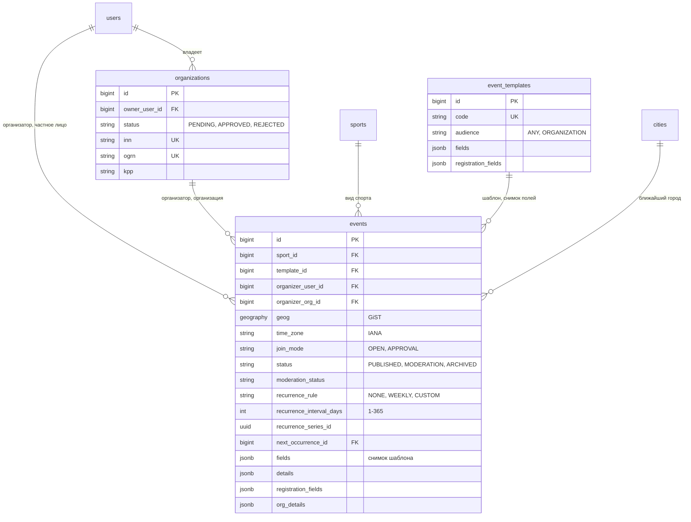
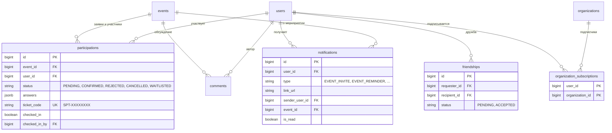
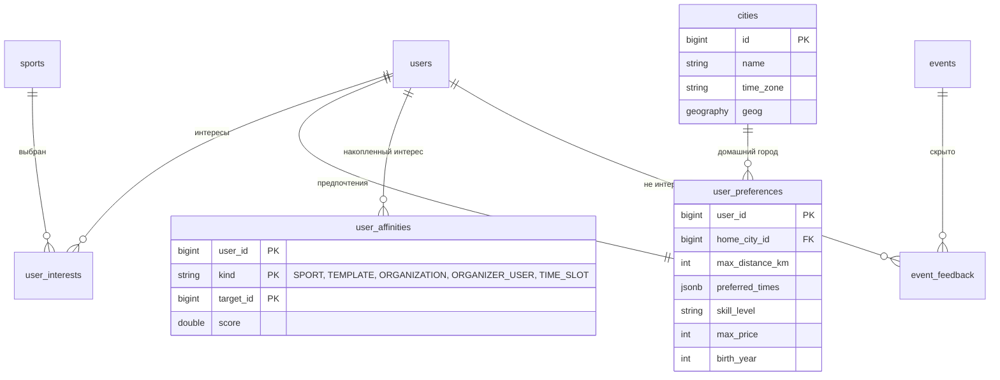

# Модель данных

PostgreSQL 16 с расширением PostGIS. Схему создают и меняют только Flyway-миграции.

## Мероприятия и организации

У события ровно один организатор: либо `organizer_user_id`, либо `organizer_org_id`. Статусы события — `PUBLISHED`, `UNPUBLISHED`, `CANCELLED`, `MODERATION`, `ARCHIVED`; статусы автопроверки — `CLEAN`, `PENDING`, `FLAGGED`, `REJECTED`, `REVIEWED`. Повторяющиеся занятия одной серии связаны общим `recurrence_series_id`; `next_occurrence_id` указывает на следующее занятие (`ON DELETE SET NULL`, уникален).

## Участие, обсуждение и социальные связи

## Персонализация и рекомендации

Отдельно, без внешних ключей: `recommendation_log` (журнал показов и действий, секционирован по месяцам) и два материализованных представления — `mv_event_popularity` и `mv_sport_similarity`.

## Ограничения целостности

- `CHECK`: у события ровно один организатор; `end_time > start_time`; `capacity > 0`.
- Уникальность `(event_id, user_id)` в участиях и `ticket_code` у билетов.
- Частичные уникальные индексы по ИНН и ОГРН организаций.
- В `friendships` — `CHECK (requester_id <> recipient_id)`, статус из набора `PENDING` и `ACCEPTED`, уникальный индекс по неупорядоченной паре `(LEAST, GREATEST)`: одна строка на пару пользователей.
- У подписок составной первичный ключ `(user_id, organization_id)`.
- Частичный уникальный индекс `uq_notifications_event_reminder (user_id, event_id, type) WHERE type = 'EVENT_REMINDER'`: одно напоминание на участника и мероприятие.
- В `events`: `CHECK` на `recurrence_interval_days` от 1 до 365, уникальность `next_occurrence_id` (у занятия не больше одного предыдущего), индекс по `recurrence_series_id`.

## Миграции

Каталог `backend/src/main/resources/db/migration`:

| Файл | Содержимое |
|------|------------|
| `V1__init_schema.sql` | Пользователи, организации, виды спорта, мероприятия, участия, комментарии |
| `V2__event_constructor.sql` | Шаблоны конструктора, детали организаций, поля участия, справочник видов спорта |
| `V3__recommendations.sql` | PostGIS, города и часовые пояса, интересы, сигналы, обратная связь, лог, материализованные представления |
| `V4__registration_profiles.sql` | Реквизиты организаций (ИНН, ОГРН, КПП) и их уникальность |
| `V5__event_moderation.sql` | Результат автопроверки мероприятия: статус, причина, находки фильтра, модель ИИ |
| `V6__friendships.sql` | Дружба пользователей |
| `V7__organization_subscriptions.sql` | Подписки на организации |
| `V8__tickets_and_checkin.sql` | Код билета, отметка о входе; коды для уже подтверждённых участий |
| `V9__notifications_and_invites.sql` | Центр уведомлений и приглашения друзей (демо-уведомления — в `R__demo_data.sql`) |
| `V10__number_field_bounds.sql` | Границы числовых полей шаблонов (расстояние, число команд и игроков, длительность) |
| `V11__recurring_events.sql` | Повторяющиеся мероприятия: правило, серия, ссылка на следующее занятие |
| `V12__custom_recurrence_interval.sql` | Свой интервал повторения в днях (1–365), еженедельные получают 7 |
| `V13__event_reminders.sql` | Уникальный индекс напоминаний о мероприятиях |
| `V14__foreign_key_indexes.sql` | Индексы внешних ключей и частых выборок (владелец организации, уведомления, ссылки на пользователя); удаление дублирующих индексов |
| `R__demo_data.sql` | Повторяемая миграция: идемпотентные демо-данные |

!!! note "Порядок миграций"
    Включён `spring.flyway.out-of-order`, потому что `V5` пришла из слияния ветки позже уже применённой `V6`. На чистой базе миграции идут в обычном порядке.
