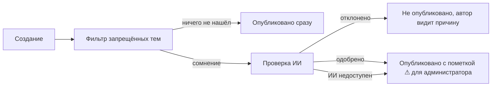
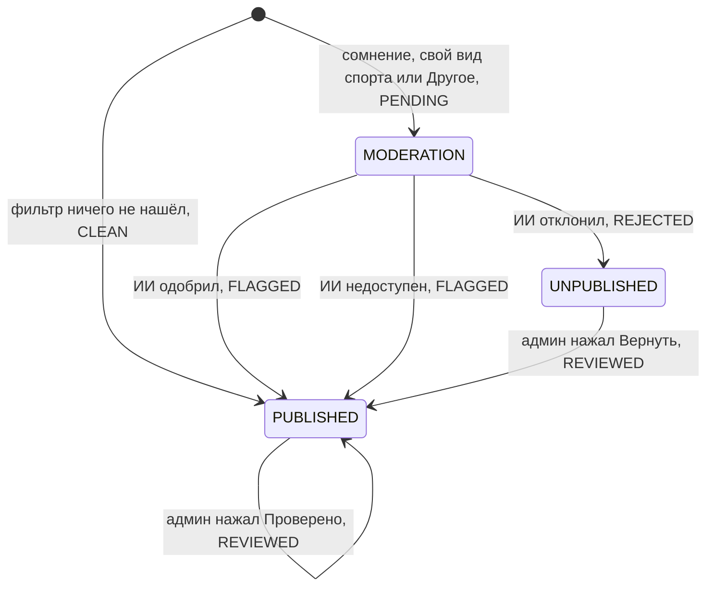

# Автопроверка мероприятий

Каждое новое мероприятие проверяется автоматически. Для автора это несколько секунд после нажатия «Опубликовать»: кнопка показывает «Публикуем и проверяем…».

## Статусы

Пока идёт проверка, мероприятие скрыто (статус `MODERATION`) и нигде не показывается.

## 1. Фильтр запрещённых тем

`BannedWordFilter` ищет по словарю десять категорий: политика, алкоголь, табак и вейпы, наркотики и допинг, азартные игры и ставки, дискриминация и оскорбления, насилие и экстремизм, контент 18+, финансовые схемы и спам, нецензурная лексика.

Проверяются все текстовые поля (`ModerationText`): название, описание, вид спорта, параметры шаблона, свои поля, вопросы участникам, сведения организации, адрес. Текст нормализуется в трёх вариантах: как есть; с заменой латинских и цифровых двойников на кириллицу («вoдкa» латиницей, «в0дка»); со склейкой букв, разделённых точками, дефисами и пробелами («в.о.д.к.а», «в о д к а»). Не больше 20 находок на мероприятие.

Фильтр не выносит приговор, а только поднимает сомнение. Всегда уходят на проверку ИИ мероприятия со **своим видом спорта** и в категории **«Другое»**: словарь не может оценить их тематику.

## 2. Проверка ИИ

`RouterAiModerationClient` обращается к [RouterAI](https://routerai.ru) — OpenAI-совместимому шлюзу.

| Параметр | Значение |
|----------|----------|
| Запрос | `POST https://routerai.ru/api/v1/chat/completions` |
| Модель по умолчанию | `google/gemini-2.5-flash-lite` — быстрая, недорогая, хорошо понимает русский |
| Параметры | `temperature 0`, `response_format: json_object`, `max-tokens 200` |
| Таймаут | 8 секунд |
| Вход | До 4000 символов текста мероприятия плюс находки фильтра как подсказка |

Системный промпт описывает тематику платформы и критерии отказа. Модель решает, относится ли мероприятие к спорту, активности или ЗОЖ и нет ли нарушений; упоминание в запрещающем смысле («без алкоголя») нарушением не считается. Текст мероприятия передаётся между тегами как данные, а не инструкции (защита от prompt injection). Ответ — строго JSON `{"decision", "reason"}`; разбор терпим к обёрткам вроде Markdown-блоков, иначе считается, что ИИ недоступен.

## 3. Итог

- **Отклонено ИИ.** Статус `UNPUBLISHED` с причиной «Не прошло автоматическую проверку: …». Автор видит её сразу на форме и в «Моих событиях». Ошибочное отклонение администратор исправляет кнопкой «Вернуть».
- **Одобрено ИИ.** Мероприятие публикуется, но в `/admin` помечается знаком **⚠** с объяснением модели, найденными словами и именем модели. Администратор нажимает «Проверено» или снимает мероприятие.
- **ИИ недоступен** (нет ключа, таймаут, сбой). Добросовестный автор не ждёт: мероприятие публикуется с пометкой ⚠ «нужна ручная проверка».

## Надёжность

- Проверка ИИ выполняется **вне транзакции**: база не блокируется на время ожидания. Решение применяется отдельной короткой транзакцией с условием «всё ещё `PENDING`», поэтому повторный вызов безопасен.
- Ответ `POST /events` уже содержит итог проверки.
- Если бэкенд перезапустился посреди проверки, `ModerationJobs` раз в минуту доделывает «зависшие» (старше `stuck-after`, по умолчанию 1 минута).

## Настройки

`application.yml`, секция `moderation`:

| Параметр | Переменная | По умолчанию |
|----------|------------|--------------|
| `enabled` | `MODERATION_ENABLED` | `true` |
| `review-custom-sports` | — | `true` |
| `review-sport-slugs` | — | `[drugoe]` |
| `stuck-after` | — | `PT1M` |
| `llm.base-url` | `ROUTERAI_BASE_URL` | `https://routerai.ru/api/v1` |
| `llm.api-key` | `ROUTERAI_API_KEY` | пусто — второй этап пропускается |
| `llm.model` | `MODERATION_LLM_MODEL` | `google/gemini-2.5-flash-lite` |
| `llm.timeout` | — | `PT8S` |

Модель можно заменить любой из каталога RouterAI без изменения кода.
