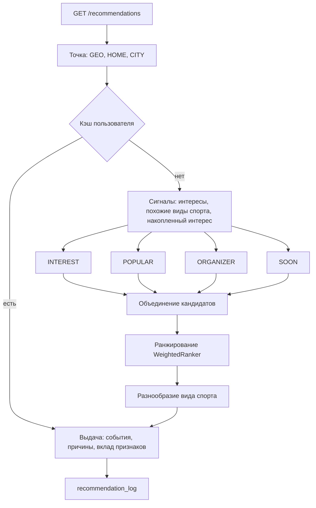

# Рекомендательная система

Страница **«Для вас»** (`/recommended`) подбирает мероприятия по интересам, месту, времени и истории пользователя. Каждая карточка показывает причины, а кнопка «Не интересно» скрывает событие и понижает похожие (с возможностью отмены).

Рекомендации строятся внутри бэкенда на данных PostgreSQL + PostGIS, без отдельного поискового кластера: данные всегда свежие (свободные места, статус, заявки), нет синхронизации индекса.



## 1. Кандидаты

Каждый из четырёх источников делает один запрос к GiST-индексу и берёт не больше `candidates-per-source` событий (по умолчанию 300) — поэтому даже в плотном городе на ранжирование попадает ограниченное число строк.

| Источник | Что отбирает |
|----------|--------------|
| `INTEREST` | Виды спорта из интересов, похожие виды и те, куда пользователь уже ходит; ближайшие |
| `POPULAR` | Самое популярное рядом (предрассчитанная `mv_event_popularity`) |
| `ORGANIZER` | События организаторов и клубов, к которым пользователь уже ходил |
| `SOON` | Ближайшее по времени рядом — разведка и запасной вариант |

Жёсткие фильтры для всех источников: событие опубликовано; начинается в пределах горизонта (30 дней); регистрация открыта; в радиусе пользователя; не своё мероприятие и нет активной или отклонённой заявки; не скрыто кнопкой «Не интересно»; подходит по бюджету и возрасту (если указаны). Мероприятия без свободных мест отсеиваются при ранжировании.

**Точка поиска:** геолокация устройства → домашняя точка → центр домашнего города.

## 2. Ранжирование

`WeightedRanker`, модель `weighted-v1`: взвешенная сумма нормированных признаков минус штраф за отвергнутое.

| Признак | Вес | Смысл |
|---------|-----|-------|
| `interest` | 0,35 | Явный интерес; для похожих видов — частичный балл |
| `distance` | 0,20 | Экспоненциальное затухание с расстоянием |
| `affinity` | 0,15 | Куда пользователь реально ходит (вид спорта, формат) |
| `urgency` | 0,10 | Чем скорее начало, тем выше |
| `skill` | 0,08 | Совпадение уровня подготовки |
| `social` | 0,07 | Популярность и заполненность |
| `organizer` | 0,05 | Знакомый организатор |
| `time` | 0,05 | Удобное время — по местному времени площадки |
| `dislike-penalty` | −0,30 | Штраф за виды спорта и организаторов, от которых отказывались |

Для каждого элемента формируется до трёх причин («Вы интересуетесь: Бег», «1,4 км от вас», «Завтра в 07:00», «Тем, кто любит Футбол, нравится Волейбол») и словарь `breakdown` с вкладом каждого признака.

**Разнообразие.** В выдаче не больше двух событий одного вида спорта подряд (`max-same-sport-in-row`).

## 3. Накопленные сигналы

События живут несколько дней, поэтому система учится на устойчивых сущностях — виде спорта, шаблоне, организаторе, времени суток (`user_affinities`). Действия обновляют вес мгновенно: запись `+1`, отмена `−0,5`, «Не интересно» `−0,5`, клик `+0,15`. Значения затухают экспоненциально, период полураспада — 90 дней.

**Похожие виды спорта.** Материализованное представление `mv_sport_similarity` считает косинусное сходство видов по совместной встречаемости у одних и тех же пользователей.

## 4. Холодный старт

Без интересов и истории выдача строится на `POPULAR` и `SOON`, а клиент приглашает указать интересы. Если неизвестно и местоположение, ответ содержит `needsLocation = true`.

## 5. Кэш и фоновые задачи

- Готовая выдача кэшируется на пользователя и точку (с точностью около 1 км) на 2 минуты и сбрасывается при записи, отмене, решении организатора, «Не интересно» и смене предпочтений. Реализация `InMemoryRecommendationCache` скрыта за интерфейсом `RecommendationCache`.
- `RecommendationJobs`: популярность обновляется каждые 5 минут; ночью (03:30) пересчитываются похожие виды спорта, пересобираются сигналы из истории и создаются секции журнала на текущий и следующий месяц. Каждая задача берёт `pg_try_advisory_xact_lock`, поэтому при нескольких экземплярах бэкенда выполняется ровно в одном.

## 6. Журнал

`recommendation_log` хранит показы (`IMPRESSION`, позиция, балл, модель, `request_id`), клики, отказы и записи. Это источник метрик (CTR, доля записавшихся) и обучающая выборка для следующей версии ранжирования.

## Интересы

Интересы задаются через `PUT /api/v1/me/preferences`: вид спорта, город, радиус, уровень, удобное время, бюджет, год рождения. В интерфейсе их собирает блок «Мои интересы» в профиле и кнопка «Мои интересы» на странице рекомендаций — это одна и та же форма. Регистрация интересы не запрашивает.

## Настройка без пересборки

`application.yml`, секция `recommendations`:

```yaml
recommendations:
  default-radius-km: 25
  horizon-days: 30
  candidates-per-source: 300
  cache-ttl: PT2M
  max-same-sport-in-row: 2
  affinity-half-life-days: 90
  weights: { interest: 0.35, distance: 0.20, affinity: 0.15, urgency: 0.10,
             skill: 0.08, social: 0.07, organizer: 0.05, time: 0.05, dislike-penalty: 0.30 }
  jobs: { enabled: true, popularity-refresh: PT5M, nightly-cron: "0 30 3 * * *" }
```

## Точки расширения

| Интерфейс | Что даёт |
|-----------|----------|
| `CandidateSource` | Новый источник кандидатов — ещё один бин |
| `Ranker` | Другая модель ранжирования; имя модели пишется в журнал для сравнения вариантов |
| `RecommendationCache` | Кэш в Redis при работе нескольких экземпляров бэкенда |

## Почему не Elasticsearch и не обученная модель

- **Без Elasticsearch.** Для рекомендаций важны свежие данные и геопоиск, а не полнотекстовый поиск; индекс отставал бы от БД. Если понадобится текстовый поиск на всю страну, его можно добавить отдельно.
- **Формула вместо LTR.** Реальных данных для обучения пока нет, а модель, обученная на сгенерированных данных, лишь воспроизвела бы формулу. Журнал и интерфейс `Ranker` готовы: обученная модель подключается заменой бина, когда накопится трафик.
