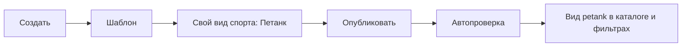
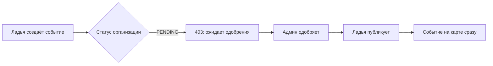
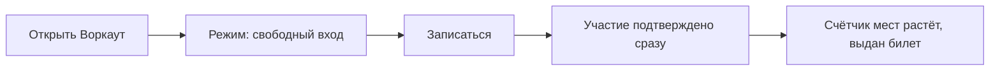
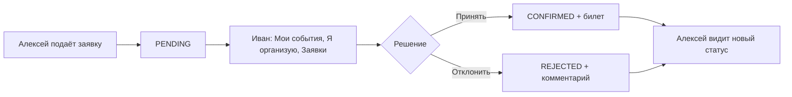
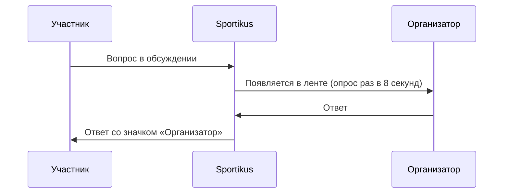
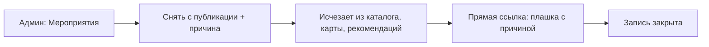
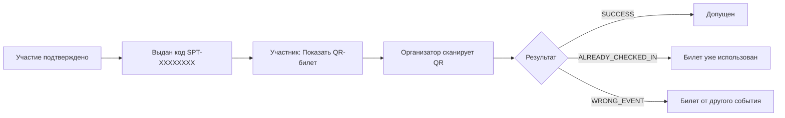
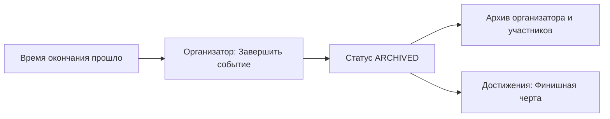
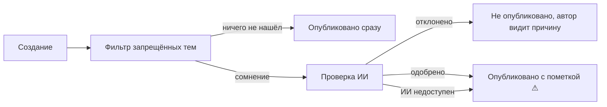

# User flows

Пошаговые пути по ключевым сценариям. Первые шесть — обязательные сценарии ТЗ; проверять их нужно на свежей базе (`docker compose down -v && docker compose up --build -d`).

## 1. Создание мероприятия с новым видом спорта

**Кто:** Иван (`user@sport.ru`).

Название нормализуется в slug (`Воркаут` → `vorkaut`), вид попадает в общий каталог, фильтры и `GET /sports`. Мероприятие со своим видом спорта всегда проходит проверку ИИ.

## 2. Допуск организации и публикация

**Кто:** Клуб «Ладья» (`ladya@sport.ru`) и администратор (`admin@sport.ru`).

Новую организацию можно зарегистрировать на `/auth`: название, ИНН, ОГРН, КПП.

## 3. Свободное присоединение

**Кто:** Ольга (`olga@sport.ru`).

## 4. Участие по заявке

**Кто:** Иван (организатор) и Алексей (`pro@sport.ru`, участник).

## 5. Уточнение условий в обсуждении

**Кто:** Ольга или Алексей и Иван (автор).

Администратор может скрыть сообщение — остальные увидят «Сообщение скрыто модератором».

## 6. Снятие мероприятия с публикации

**Кто:** Администратор.

Пример: `/events/5`.

## 7. Билет и вход на мероприятие

**Кто:** участник и организатор.

## 8. Завершение и архив

## 9. Автопроверка нового мероприятия

Подробности — в разделе [Автопроверка мероприятий](../technical/moderation.md).
