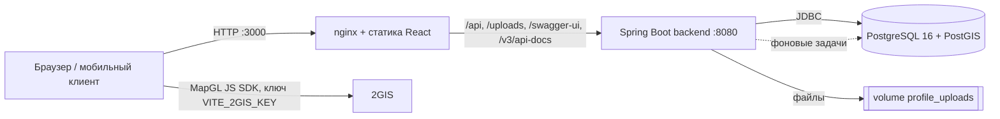
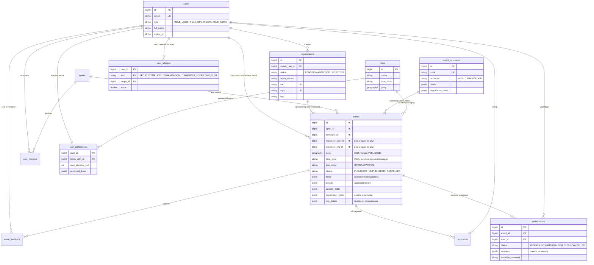
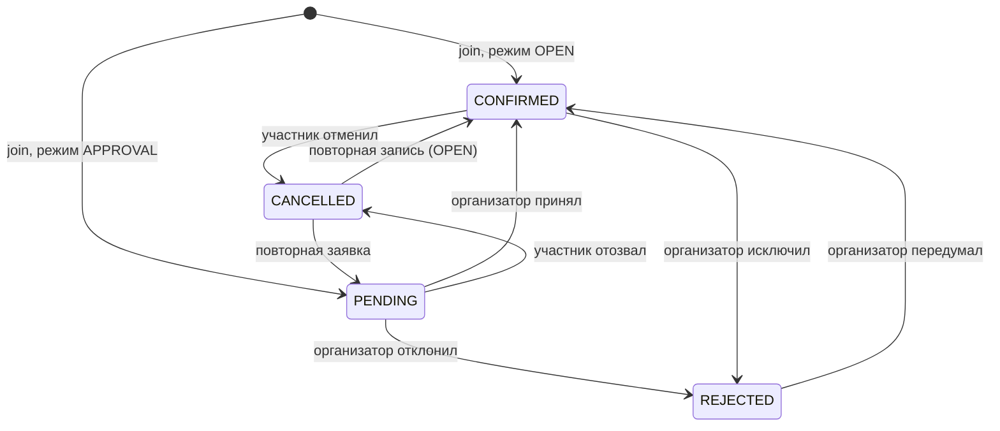
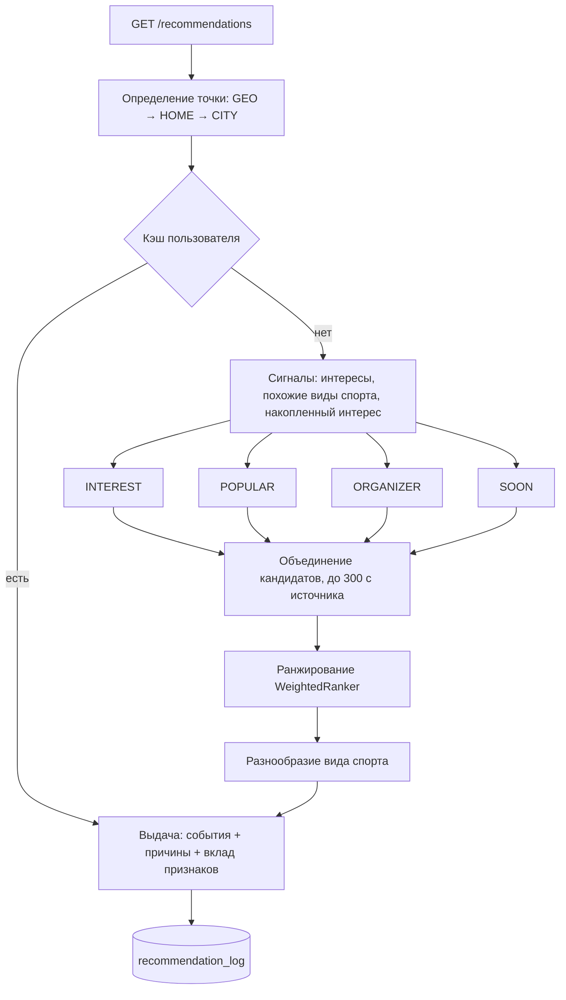

# Архитектура Sportikus

Документ описывает устройство платформы: компоненты, модель данных, ключевые потоки, рекомендательную систему и принятые решения. Как запустить проект и как им пользоваться — в [корневом README](../README.md); все эндпоинты — в Swagger UI.

## Содержание

1. [Принципы](#1-принципы)
2. [Компоненты и развёртывание](#2-компоненты-и-развёртывание)
3. [Модули backend](#3-модули-backend)
4. [Модель данных](#4-модель-данных)
5. [Ключевые потоки](#5-ключевые-потоки)
6. [Рекомендательная система](#6-рекомендательная-система)
7. [География и время](#7-география-и-время)
8. [Безопасность](#8-безопасность)
9. [Архитектурные решения](#9-архитектурные-решения)
10. [Ограничения и развитие](#10-ограничения-и-развитие)

---

## 1. Принципы

* **API-first.** Вся бизнес-логика и проверка прав — на Java-бэкенде; веб-клиент — один из потребителей REST API. Тот же API подходит мобильному приложению.
* **Данные вместо кода.** Формат мероприятия (поля, вопросы участнику, значения по умолчанию) задаётся JSON-схемой в таблице `event_templates`. Новый вид активности — строка в БД, а не релиз.
* **Package-by-feature.** Каждый модуль (`event`, `participation`, `recommendation`…) содержит свои `controller / service / repository / model / dto`; зависимости между модулями идут через сервисы и доменные события.
* **Масштаб страны с первого дня.** Геопоиск на PostGIS с GiST-индексом, местное время площадки в её часовом поясе, ограниченные выборки (кандидаты, каталог), расчёты в фоне.
* **Объяснимость.** Рекомендация всегда приходит с причинами и вкладом каждого признака — пользователь понимает, почему ему это показали, а команда может настраивать веса без переобучения.
* **Предсказуемые ошибки.** Единый формат `{"error": {"code", "message"}}` и осмысленные HTTP-статусы (`400/401/403/404/409`).

## 2. Компоненты и развёртывание

Три контейнера в `docker-compose.yml`:

| Сервис | Образ | Роль |
| :--- | :--- | :--- |
| `postgres` | `postgis/postgis:16-3.4-alpine` | Данные, геоиндекс, материализованные представления |
| `backend` | сборка `backend/Dockerfile` (Maven → JRE 21) | REST API, JWT, фоновые задачи, раздача `/uploads/**` |
| `frontend` | сборка `frontend/Dockerfile` (Node → nginx) | SPA и reverse-proxy к бэкенду |

Миграции схемы выполняет Flyway при старте бэкенда; Hibernate работает в режиме `ddl-auto: validate` и схему не меняет.

## 3. Модули backend

Пакет `ru.sportikus`:

| Модуль | Ответственность |
| :--- | :--- |
| `auth`, `security` | Вход, регистрация пользователя и организации, JWT (`JwtService`, `JwtAuthFilter`), `CurrentUser` |
| `user` | Пользователи, публичные профили, загрузка фото, личный кабинет (`/me/*`) |
| `organization` | Организации и их статусы `PENDING → APPROVED / REJECTED`, реквизиты ИНН/ОГРН/КПП |
| `sport` | Справочник видов спорта; ввод нового вида нормализуется в slug (`SlugUtil`) и не плодит дубли |
| `template`, `form` | Конструктор: шаблоны, описания полей (`FieldDef`), универсальный валидатор значений (`FieldValidator`) |
| `event` | Мероприятия, каталог с фильтрами и геопоиском, экспорт `.ics`, сведения организатора (`OrgDetails`) |
| `participation` | Запись и заявки, решения организатора, блокировка мест, доменные события |
| `comment` | Обсуждение под мероприятием: сообщения, значок организатора, мягкое скрытие, лента для модерации |
| `admin` | Модерация организаций и снятие мероприятий с публикации |
| `city` | Справочник городов, ближайший город к точке, часовые пояса |
| `preference` | Интересы и предпочтения пользователя (`/me/preferences`) |
| `recommendation` | Источники кандидатов, ранжирование, сигналы, кэш, лог, фоновые задачи |
| `common`, `config` | `ApiException`, единый обработчик ошибок, Security, OpenAPI, планировщик, раздача файлов |

## 4. Модель данных

Отдельно, без внешних ключей: `recommendation_log` (журнал показов и действий, секционирован по месяцам) и два материализованных представления — `mv_event_popularity` и `mv_sport_similarity`.

Ограничения целостности: `CHECK` на ровно одного организатора события, на `end_time > start_time`, на `capacity > 0`; уникальность `(event_id, user_id)` в участиях и частичные уникальные индексы по ИНН и ОГРН.

Миграции (`backend/src/main/resources/db/migration`):

| Файл | Содержимое |
| :--- | :--- |
| `V1__init_schema.sql` | Пользователи, организации, виды спорта, мероприятия, участия, комментарии |
| `V2__event_constructor.sql` | Шаблоны конструктора, детали организаций, поля участия, справочник видов спорта |
| `V3__recommendations.sql` | PostGIS, города и часовые пояса, интересы, сигналы, обратная связь, лог, материализованные представления |
| `V4__registration_profiles.sql` | Реквизиты организаций (ИНН/ОГРН/КПП) и их уникальность |
| `R__demo_data.sql` | Повторяемая миграция: идемпотентные демо-данные |

## 5. Ключевые потоки

### Публикация мероприятия

1. Клиент загружает шаблоны (`GET /templates`), пользователь выбирает формат и заполняет поля.
2. `POST /events`: проверяется роль (администратор не создаёт), для организации — статус `APPROVED` (иначе `403`) и обязательные контакты; значения полей валидируются по схеме шаблона (`FieldValidator`), вопросы участнику — по определениям.
3. Вид спорта находится по id или создаётся по названию (slug), по координатам определяется ближайший город и часовой пояс, поля шаблона копируются в событие снимком.
4. Событие сразу публикуется — без премодерации.

### Участие с подтверждением

Все операции с местами выполняются под `SELECT … FOR UPDATE` на строке мероприятия, поэтому последнее место нельзя выдать дважды. Проверяются: собственное мероприятие, снятие с публикации, завершение, закрытая регистрация, повторные заявки, лимит мест, обязательные ответы анкеты и подтверждение требований. Каждое изменение статуса публикует `ParticipationChangedEvent`, на который подписана рекомендательная система.

### Обсуждение под мероприятием

Таблица `comments` (`text`, `is_organizer`, `is_hidden`). Читать обсуждение можно без входа, писать — после входа (до 2000 символов). Признак `is_organizer` выставляет сервис, а не клиент: автор мероприятия или владелец организации-организатора получают значок «Организатор». Скрытие мягкое (`is_hidden`): `CommentDto` подменяет текст заглушкой «Сообщение скрыто модератором» для всех, кроме администратора; скрыть может администратор, автор сообщения и организатор мероприятия. Клиент обновляет обсуждение опросом раз в 8 секунд.

### Модерация

Администратор одобряет или отклоняет организацию (с обязательной причиной), снимает мероприятия с публикации (с обязательной причиной) и скрывает комментарии. Снятое мероприятие исчезает из каталога, карты и рекомендаций, но доступно по прямой ссылке с плашкой причины; запись на него закрыта.

## 6. Рекомендательная система

Рекомендации строятся внутри бэкенда на данных PostgreSQL — без отдельного поискового кластера.

**1. Кандидаты.** Каждый из четырёх источников делает один запрос к GiST-индексу и берёт не больше `candidates-per-source` событий (по умолчанию 300) — поэтому даже в плотном городе на ранжирование попадает ограниченное число строк.

| Источник | Что отбирает |
| :--- | :--- |
| `INTEREST` | Виды спорта из интересов, похожие виды и те, куда пользователь уже ходит; ближайшие |
| `POPULAR` | Самое популярное рядом (предрассчитанная `mv_event_popularity`) |
| `ORGANIZER` | События организаторов и клубов, к которым пользователь уже ходил |
| `SOON` | Ближайшее по времени рядом — разведка и запасной вариант |

Жёсткие фильтры для всех источников: событие опубликовано; начинается в пределах горизонта (30 дней); регистрация открыта; в радиусе пользователя; не своё мероприятие и нет активной или отклонённой заявки; не скрыто кнопкой «Не интересно»; подходит по бюджету и возрасту (если указаны). Мероприятия без свободных мест отсеиваются при ранжировании.

**2. Ранжирование (`WeightedRanker`, модель `weighted-v1`).** Взвешенная сумма нормированных признаков минус штраф за отвергнутое:

| Признак | Вес | Смысл |
| :--- | :---: | :--- |
| `interest` | 0.35 | Явный интерес; для похожих видов — частичный балл |
| `distance` | 0.20 | Экспоненциальное затухание с расстоянием |
| `affinity` | 0.15 | Куда пользователь реально ходит (вид спорта, формат) |
| `urgency` | 0.10 | Чем скорее начало, тем выше |
| `skill` | 0.08 | Совпадение уровня подготовки |
| `social` | 0.07 | Популярность и заполненность |
| `organizer` | 0.05 | Знакомый организатор |
| `time` | 0.05 | Удобное время — по **местному** времени площадки |
| `dislike-penalty` | −0.30 | Штраф за виды спорта и организаторов, от которых отказывались |

Для каждого элемента формируется до трёх причин («Вы интересуетесь: Бег», «1,4 км от вас», «Завтра в 07:00», «Тем, кто любит Футбол, нравится Волейбол»…) и словарь `breakdown` с вкладом каждого признака. Веса и лимиты задаются в `application.yml` (`recommendations.*`) и меняются без пересборки.

**3. Разнообразие.** В выдаче не больше двух событий одного вида спорта подряд (`max-same-sport-in-row`).

**4. Накопленные сигналы (`user_affinities`).** События живут несколько дней, поэтому учимся на устойчивых сущностях — виде спорта, шаблоне, организаторе, времени суток. Действия обновляют вес мгновенно: запись `+1`, отмена `−0.5`, «Не интересно» `−0.5`, клик `+0.15` (вклад по типам сущностей: вид спорта 1.0, организатор 0.7, шаблон 0.5, время суток 0.3). Значения затухают экспоненциально, период полураспада — 90 дней.

**5. «Похожие виды спорта».** Материализованное представление `mv_sport_similarity` считает косинусное сходство видов по совместной встречаемости у одних и тех же пользователей (интересы и записи) с порогом поддержки `similarity-min-cooccurrence`.

**6. Холодный старт.** Если интересов и истории нет, выдача строится на `POPULAR` и `SOON`, а клиент показывает приглашение указать интересы. Если неизвестно и местоположение, ответ содержит `needsLocation = true`.

**7. Кэш.** Готовая выдача кэшируется на пользователя и точку (с точностью около 1 км) на 2 минуты и сбрасывается при записи, отмене, решении организатора, «Не интересно» и смене предпочтений. Реализация `InMemoryRecommendationCache` скрыта за интерфейсом `RecommendationCache`.

**8. Фоновые задачи (`RecommendationJobs`).** Обновление популярности каждые 5 минут; ночью (03:30) — пересчёт похожих видов спорта, полная пересборка сигналов из истории и создание секций журнала на текущий и следующий месяц. Каждая задача берёт `pg_try_advisory_xact_lock`, поэтому при нескольких экземплярах бэкенда выполняется ровно в одном.

**9. Журнал и обратная связь.** `recommendation_log` хранит показы (`IMPRESSION`, позиция, балл, модель, `request_id`), клики, отказы и записи. Это источник для метрик (CTR, доля записавшихся) и обучающая выборка для следующей версии ранжирования.

**Точки расширения** (без правок остального кода):

| Интерфейс | Что даёт |
| :--- | :--- |
| `CandidateSource` | Новый источник кандидатов — ещё один бин |
| `Ranker` | Другая модель ранжирования; имя модели пишется в журнал для сравнения вариантов |
| `RecommendationCache` | Кэш в Redis при работе нескольких экземпляров бэкенда |

## 7. География и время

* Координаты мероприятий хранятся в `lat`/`lng`; вычисляемая колонка `geog` типа `geography(Point, 4326)` проиндексирована GiST — частичным индексом только по опубликованным событиям.
* Каталог всегда ограничен областью (центр + `radiusKm`, не больше 300 км) и 500 событиями; веб-клиент запрашивает события для видимой области карты.
* Справочник `cities` содержит 44 города с часовыми поясами. При создании мероприятия ближайший город (KNN по `geog <-> точка`) определяет `city_id` и `time_zone`.
* Время передаётся в UTC. Клиент показывает его в часовом поясе площадки и подписывает «местное», если оно отличается от пояса устройства; при создании введённое время трактуется как местное время площадки. Поэтому «вечер» во Владивостоке и в Калининграде вычисляется корректно и в рекомендациях.

## 8. Безопасность

* **Аутентификация:** JWT (подпись ключом `JWT_SECRET`, срок 24 часа), без сессий; пароли — BCrypt.
* **Авторизация:** публичны только чтение каталога, карточки события, справочников и профилей, вход и регистрация (правила в `SecurityConfig`); `/api/v1/admin/**` — только `ROLE_ADMIN`; всё остальное требует токен. Права на конкретные объекты (организатор мероприятия, владелец профиля) проверяются в сервисах.
* **Регистрация организаций:** уникальные ИНН и ОГРН, валидация длины реквизитов; публикация возможна только после одобрения администратором.
* **Загрузка файлов:** только JPG, PNG, WebP до 5 МБ; имя файла — случайный UUID; файлы лежат в отдельном каталоге/volume.
* **Ошибки:** внутренние детали не раскрываются — клиент получает типизированный код и сообщение.

## 9. Архитектурные решения

| Решение | Почему |
| :--- | :--- |
| **Рекомендации на PostgreSQL + PostGIS, без Elasticsearch** | Для рекомендаций важны свежие данные (места, статус, заявки пользователя) и геопоиск, а не полнотекстовый поиск. Поисковый индекс отставал бы от БД и дублировал данные. Если понадобится поиск по тексту на всю страну, его можно добавить отдельно, не затрагивая рекомендации |
| **Формат мероприятия — JSON-схема в БД** | Платформа должна быть гибкой к любым активностям; снимок схемы в событии не ломается при правке шаблона |
| **Взвешенная формула вместо обученной модели (LTR)** | Реальных данных для обучения пока нет, а модель, обученная на сгенерированных данных, лишь воспроизвела бы формулу. Журнал `recommendation_log` и интерфейс `Ranker` уже готовы: обученная модель подключается заменой бина, когда накопится трафик |
| **Кэш в памяти, а не Redis** | Один экземпляр бэкенда — рассинхронизации нет. Интерфейс `RecommendationCache` позволяет подключить Redis без изменений движка, когда экземпляров станет несколько |
| **Блокировка строки мероприятия** | Простая и надёжная защита от двойной выдачи последнего места; нагрузка на одно мероприятие невелика |
| **Фоновые задачи с advisory-блокировкой** | Не нужен внешний планировщик, но при масштабировании задача не выполняется дважды |
| **Доменные события участия и интересов** | Рекомендации обновляются и сбрасывают кэш без жёсткой связи модулей |
| **2GIS MapGL на клиенте** | Подробная карта российских городов; ключ задаётся через `.env`, без него приложение работает с заглушкой вместо карты |

## 10. Ограничения и развитие

Текущая версия **не реализует**:

* PWA (манифест, service worker), push-уведомления, уведомления об ответах в обсуждении.
* Сквозную «Поделиться геопозицией»: в конфигурации есть флаг `features.location-sharing.enabled`, кода под ним пока нет.
* Сбор интересов при регистрации: интересы указываются в профиле (`/profile`) или на странице рекомендаций.

Известные упрощения (для хакатона):

* CORS открыт для всех источников; в продуктиве список нужно ограничить.
* Загрузки хранятся на диске (volume); для нескольких экземпляров бэкенда — объектное хранилище.
* Кэш рекомендаций локален процессу; при нескольких экземплярах — Redis.
* Обсуждение обновляется опросом, без WebSocket; для большой нагрузки — SSE или WebSocket.
* Порог «похожих видов» мал из-за демо-данных; на реальном трафике его нужно поднять.

Направления развития: обученная модель ранжирования (LTR) на журнале показов, отдельный полнотекстовый поиск, выделение рекомендаций в сервис при росте нагрузки, уведомления и реальное время для обсуждений.
