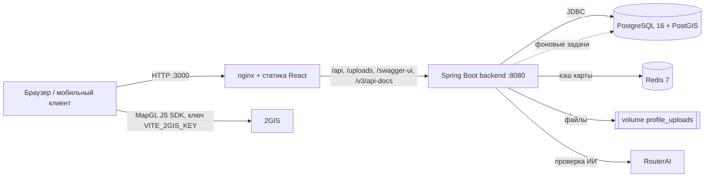
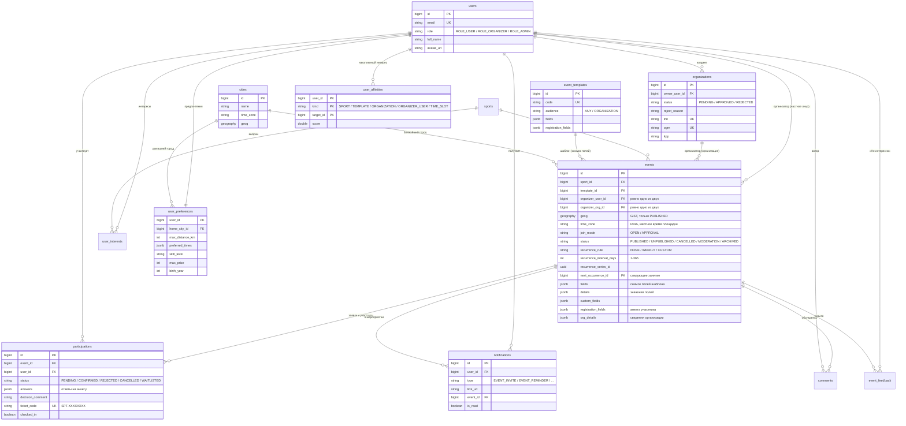
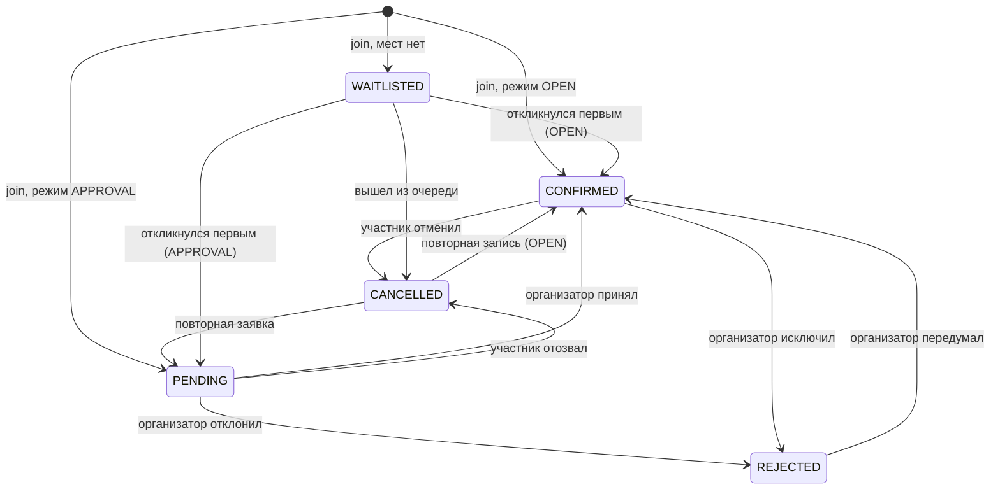
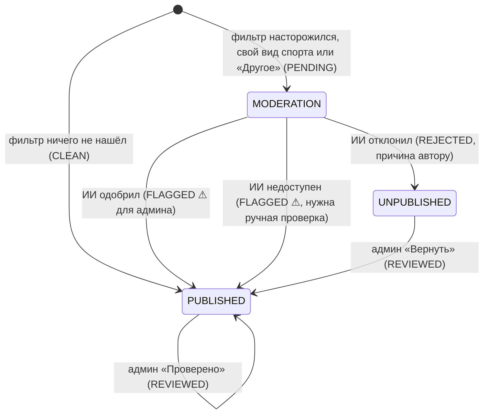
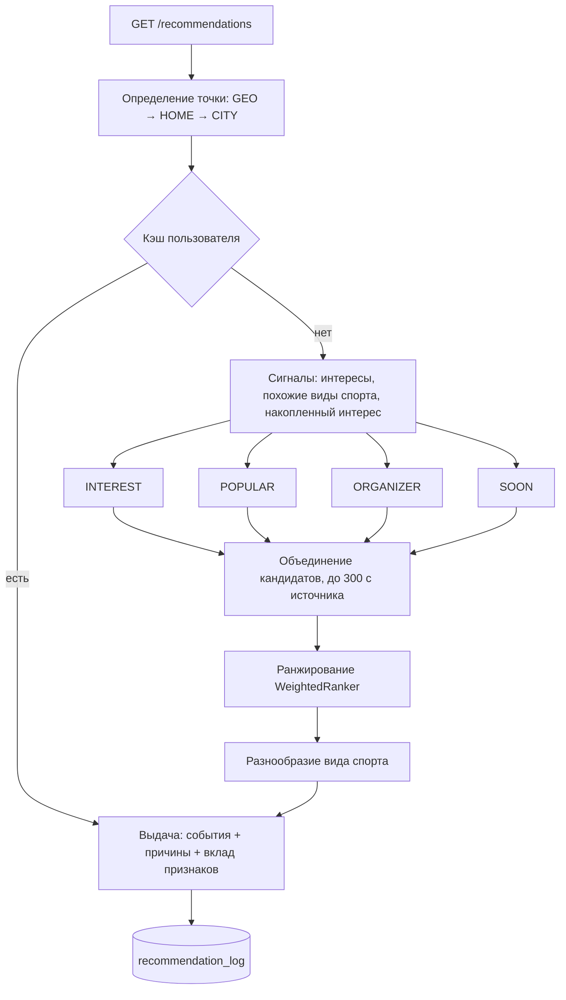

# Архитектура Sportikus

Документ описывает устройство платформы: компоненты, модель данных, ключевые потоки, рекомендательную систему и принятые решения. Как запустить проект и как им пользоваться — в [корневом README](../README.md); все эндпоинты — в Swagger UI.

## Содержание

1. [Принципы](#1-принципы)
2. [Компоненты и развёртывание](#2-компоненты-и-развёртывание)
3. [Модули backend](#3-модули-backend)
4. [Модель данных](#4-модель-данных)
5. [Ключевые потоки](#5-ключевые-потоки)
6. [Рекомендательная система](#6-рекомендательная-система)
7. [География и время](#7-география-и-время)
8. [Безопасность](#8-безопасность)
9. [Архитектурные решения](#9-архитектурные-решения)
10. [Ограничения и развитие](#10-ограничения-и-развитие)

---

## 1. Принципы

* **API-first.** Вся бизнес-логика и проверка прав — на Java-бэкенде; веб-клиент — один из потребителей REST API. Тот же API подходит мобильному приложению.
* **Данные вместо кода.** Формат мероприятия (поля, вопросы участнику, значения по умолчанию) задаётся JSON-схемой в таблице `event_templates`. Новый вид активности — строка в БД, а не релиз.
* **Package-by-feature.** Каждый модуль (`event`, `participation`, `recommendation`…) содержит свои `controller / service / repository / model / dto`; зависимости между модулями идут через сервисы и доменные события.
* **Масштаб страны с первого дня.** Геопоиск на PostGIS с GiST-индексом, местное время площадки в её часовом поясе, ограниченные выборки (кандидаты, каталог), расчёты в фоне.
* **Объяснимость.** Рекомендация всегда приходит с причинами и вкладом каждого признака — пользователь понимает, почему ему это показали, а команда может настраивать веса без переобучения.
* **Предсказуемые ошибки.** Единый формат `{"error": {"code", "message"}}` и осмысленные HTTP-статусы (`400/401/403/404/409`).

## 2. Компоненты и развёртывание

Четыре контейнера в `docker-compose.yml`:

| Сервис | Образ | Роль |
| :--- | :--- | :--- |
| `postgres` | `postgis/postgis:16-3.4-alpine` | Данные, геоиндекс, материализованные представления |
| `redis` | `redis:7-alpine` | Только кэш карты: без сохранения на диск, память 128 МБ, вытеснение `allkeys-lru` |
| `backend` | сборка `backend/Dockerfile` (Maven → JRE 21) | REST API, JWT, фоновые задачи, раздача `/uploads/**` |
| `frontend` | сборка `frontend/Dockerfile` (Node → nginx) | SPA, сжатие (gzip), кэш картинок приветственной страницы и reverse-proxy к бэкенду |

Миграции схемы выполняет Flyway при старте бэкенда; Hibernate работает в режиме `ddl-auto: validate` и схему не меняет.

## 3. Модули backend

Пакет `ru.sportikus`:

| Модуль | Ответственность |
| :--- | :--- |
| `auth`, `security` | Вход, регистрация пользователя и организации, JWT (`JwtService`, `JwtAuthFilter`), `CurrentUser` |
| `user` | Пользователи, публичные профили, загрузка фото, личный кабинет (`/me/*`) |
| `organization` | Организации и их статусы `PENDING → APPROVED / REJECTED`, реквизиты ИНН/ОГРН/КПП |
| `sport` | Справочник видов спорта; ввод нового вида нормализуется в slug (`SlugUtil`) и не плодит дубли |
| `template`, `form` | Конструктор: шаблоны, описания полей (`FieldDef`), универсальный валидатор значений (`FieldValidator`) |
| `event` | Мероприятия, каталог с фильтрами и геопоиском, повторяющиеся занятия, завершение и архив, экспорт `.ics`, сведения организатора (`OrgDetails`), кэш карты (`event.cache`) |
| `participation` | Запись и заявки, очередь на места, решения организатора, блокировка мест, билеты и отметка на входе, CSV-экспорт, доменные события |
| `comment` | Обсуждение под мероприятием: сообщения, значок организатора, мягкое скрытие, лента для модерации |
| `friendship`, `subscription`, `achievement` | Друзья, подписки на организации, 30 достижений за активность |
| `notification` | Центр уведомлений, приглашения друзей, напоминания за сутки (`notification.jobs`) |
| `stats` | Публичная сводка платформы для приветственной страницы |
| `moderation` | Автопроверка новых мероприятий: фильтр запрещённых тем, проверка ИИ через RouterAI, пометка для администратора |
| `admin` | Модерация организаций и снятие мероприятий с публикации |
| `city` | Справочник городов, ближайший город к точке, часовые пояса |
| `preference` | Интересы и предпочтения пользователя (`/me/preferences`) |
| `recommendation` | Источники кандидатов, ранжирование, сигналы, кэш, лог, фоновые задачи |
| `common`, `config` | `ApiException`, единый обработчик ошибок, Security, OpenAPI, планировщик, раздача файлов |

## 4. Модель данных

Отдельно, без внешних ключей: `recommendation_log` (журнал показов и действий, секционирован по месяцам) и два материализованных представления — `mv_event_popularity` и `mv_sport_similarity`.

Дружба (`friendships`) и подписки на организации (`organization_subscriptions`) на диаграмме не показаны. Ограничения целостности: `CHECK` на ровно одного организатора события, на `end_time > start_time`, на `capacity > 0`, на интервал повторения от 1 до 365 дней; уникальность `(event_id, user_id)` и `ticket_code` в участиях; частичные уникальные индексы по ИНН и ОГРН; частичный уникальный индекс `(user_id, event_id, type)` для напоминаний `EVENT_REMINDER`.

Миграции (`backend/src/main/resources/db/migration`):

| Файл | Содержимое |
| :--- | :--- |
| `V1__init_schema.sql` | Пользователи, организации, виды спорта, мероприятия, участия, комментарии |
| `V2__event_constructor.sql` | Шаблоны конструктора, детали организаций, поля участия, справочник видов спорта |
| `V3__recommendations.sql` | PostGIS, города и часовые пояса, интересы, сигналы, обратная связь, лог, материализованные представления |
| `V4__registration_profiles.sql` | Реквизиты организаций (ИНН/ОГРН/КПП) и их уникальность |
| `V5__event_moderation.sql` | Результат автопроверки мероприятия: статус, причина, находки фильтра, модель ИИ |
| `V6__friendships.sql` | Дружба пользователей |
| `V7__organization_subscriptions.sql` | Подписки на организации |
| `V8__tickets_and_checkin.sql` | Код билета, отметка о входе |
| `V9__notifications_and_invites.sql` | Центр уведомлений и приглашения друзей |
| `V10__number_field_bounds.sql` | Границы числовых полей шаблонов |
| `V11__recurring_events.sql` | Повторяющиеся мероприятия: правило, серия, следующее занятие |
| `V12__custom_recurrence_interval.sql` | Свой интервал повторения в днях |
| `V13__event_reminders.sql` | Уникальный индекс напоминаний |
| `V14__foreign_key_indexes.sql` | Индексы внешних ключей и частых выборок |
| `R__demo_data.sql` | Повторяемая миграция: идемпотентные демо-данные |

## 5. Ключевые потоки

### Публикация мероприятия

1. Клиент загружает шаблоны (`GET /templates`), пользователь выбирает формат и заполняет поля.
2. `POST /events`: проверяется роль (администратор не создаёт), для организации — статус `APPROVED` (иначе `403`) и обязательные контакты; значения полей валидируются по схеме шаблона (`FieldValidator`), вопросы участнику — по определениям.
3. Вид спорта находится по id или создаётся по названию (slug), по координатам определяется ближайший город и часовой пояс, поля шаблона копируются в событие снимком.
4. Автопроверка (раздел ниже): чистое мероприятие публикуется сразу, сомнительное — после решения ИИ. Ручной премодерации нет.

### Участие с подтверждением

Все операции с местами выполняются под `SELECT … FOR UPDATE` на строке мероприятия, поэтому последнее место нельзя выдать дважды. Проверяются: собственное мероприятие, снятие с публикации, завершение, закрытая регистрация, повторные заявки, лимит мест, обязательные ответы анкеты и подтверждение требований. Каждое изменение статуса публикует `ParticipationChangedEvent`, на который подписана рекомендательная система.

**Очередь.** Когда мест нет (или в очереди уже кто-то есть), запись получает статус `WAITLISTED` и места не занимает. Если подтверждённый участник отменяет запись или организатор его исключает, все ожидающие получают уведомление `WAITLIST_SPOT_AVAILABLE`, а место достаётся первому, кто повторит `POST /events/{id}/join`; остальным приходит `WAITLIST_SPOT_TAKEN`. Таймеров нет, подтвердить заявку из очереди организатор не может.

### Билеты и вход

При подтверждении участия выдаётся код билета `SPT-XXXXXXXX` (8 символов случайного UUID, уникален). `POST /events/{id}/checkin` доступен организатору мероприятия и администратору и отвечает `SUCCESS`, `ALREADY_CHECKED_IN`, `WRONG_EVENT`, `NOT_CONFIRMED` или `NOT_FOUND`; ответ содержит имя и аватар участника, признак платного входа и цену. Код постоянный, вход по нему одноразовый. Клиентский сканер открывается на весь экран, умеет камеру (только `https://` или `localhost`), фото с QR, фонарик и ручной ввод, а повтор того же кода в течение 15 секунд игнорирует. Подробности — в разделе «Архитектура» документации Zensical.

### Завершение, архив и повторы

`POST /events/{id}/complete` переводит мероприятие в `ARCHIVED` (только организатор, только после времени окончания; повторное завершение и завершение снятого — `409`). Если задан `recurrenceRule` (`WEEKLY` или `CUSTOM` с интервалом 1–365 дней), в той же транзакции создаётся следующее занятие: копия полей, анкеты, цены, лимита и результата автопроверки со сдвигом начала на интервал **по местному времени площадки** (и не в прошлое); ссылка на него — `next_occurrence_id`. Участники не переносятся, расписание наперёд не строится.

### Уведомления, приглашения и напоминания

Таблица `notifications` хранит получателя, тип, текст, ссылку, отправителя и мероприятие. Типы: `EVENT_INVITE`, `EVENT_REMINDER`, `PARTICIPATION_CONFIRMED`, `PARTICIPATION_REJECTED`, `FRIEND_REQUEST`, `FRIEND_ACCEPTED`, `WAITLIST_SPOT_AVAILABLE`, `WAITLIST_SPOT_TAKEN` (и зарезервированные `NEW_COMMENT`, `SYSTEM`). Клиент опрашивает список раз в 20 секунд.

* **Приглашения** (`EventInviteService`): друга одного человека на одно мероприятие зовут один раз; уже идущие (`PENDING`, `CONFIRMED`, `WAITLISTED`, организаторы) пропускаются; звать можно только на опубликованное мероприятие, которое не закончилось; сообщение — до 300 символов.
* **Напоминания** (`EventReminderJobs` → `EventReminderService`): раз в 5 минут (`notifications.reminders.fixed-delay`) один `INSERT … SELECT … ON CONFLICT DO NOTHING` создаёт `EVENT_REMINDER` каждому подтверждённому участнику опубликованного мероприятия, которое начнётся в ближайшие 24 часа. Частичный уникальный индекс гарантирует одно напоминание на пару «участник + мероприятие», в том числе при нескольких экземплярах бэкенда.

### Автопроверка мероприятия

1. **Фильтр** (`BannedWordFilter`) работает внутри транзакции создания: регулярные выражения по словарю из 10 категорий (политика, алкоголь, табак, наркотики и допинг, ставки, дискриминация, насилие, 18+, финансовые схемы, мат) по всем текстовым полям (`ModerationText`). Текст нормализуется в трёх вариантах — как есть, с заменой латинских и цифровых двойников на кириллицу, со склейкой букв через точки, дефисы и пробелы. Мероприятия со своим видом спорта и в категории «Другое» отправляются ИИ всегда — словарь не оценивает тематику.
2. **ИИ** (`RouterAiModerationClient`) вызывается после коммита и **вне транзакции**: `POST https://routerai.ru/api/v1/chat/completions`, модель `google/gemini-2.5-flash-lite`, `temperature 0`, `response_format: json_object`, таймаут 8 с. Системный промпт описывает тематику платформы и критерии отказа; текст мероприятия передаётся между тегами как данные (защита от prompt injection); находки фильтра даются как подсказка. Ответ `{"decision", "reason"}` разбирается терпимо к обёрткам, иначе считается, что ИИ недоступен.
3. **Применение решения** — отдельная короткая транзакция с условием «всё ещё PENDING», поэтому повторный вызов безопасен. Ответ `POST /events` уже содержит итог. Если процесс упал посреди проверки, `ModerationJobs` раз в минуту доделывает «зависшие» проверки.
4. **Отказоустойчивость:** недоступность ИИ не блокирует автора — мероприятие публикуется с пометкой ⚠, администратор проверяет вручную.

### Обсуждение под мероприятием

Таблица `comments` (`text`, `is_organizer`, `is_hidden`). Читать обсуждение можно без входа, писать — после входа (до 2000 символов). Признак `is_organizer` выставляет сервис, а не клиент: автор мероприятия или владелец организации-организатора получают значок «Организатор». Скрытие мягкое (`is_hidden`): `CommentDto` подменяет текст заглушкой «Сообщение скрыто модератором» для всех, кроме администратора; скрыть может администратор, автор сообщения и организатор мероприятия. Клиент обновляет обсуждение опросом раз в 8 секунд.

### Модерация

Администратор одобряет или отклоняет организацию (с обязательной причиной), снимает мероприятия с публикации (с обязательной причиной) и скрывает комментарии. Снятое мероприятие исчезает из каталога, карты и рекомендаций, но доступно по прямой ссылке с плашкой причины; запись на него закрыта.

## 6. Рекомендательная система

Рекомендации строятся внутри бэкенда на данных PostgreSQL — без отдельного поискового кластера.

**1. Кандидаты.** Каждый из четырёх источников делает один запрос к GiST-индексу и берёт не больше `candidates-per-source` событий (по умолчанию 300) — поэтому даже в плотном городе на ранжирование попадает ограниченное число строк.

| Источник | Что отбирает |
| :--- | :--- |
| `INTEREST` | Виды спорта из интересов, похожие виды и те, куда пользователь уже ходит; ближайшие |
| `POPULAR` | Самое популярное рядом (предрассчитанная `mv_event_popularity`) |
| `ORGANIZER` | События организаторов и клубов, к которым пользователь уже ходил |
| `SOON` | Ближайшее по времени рядом — разведка и запасной вариант |

Жёсткие фильтры для всех источников: событие опубликовано; начинается в пределах горизонта (30 дней); регистрация открыта; в радиусе пользователя; не своё мероприятие и нет активной или отклонённой заявки; не скрыто кнопкой «Не интересно»; подходит по бюджету и возрасту (если указаны). Мероприятия без свободных мест отсеиваются при ранжировании.

**2. Ранжирование (`WeightedRanker`, модель `weighted-v1`).** Взвешенная сумма нормированных признаков минус штраф за отвергнутое:

| Признак | Вес | Смысл |
| :--- | :---: | :--- |
| `interest` | 0.35 | Явный интерес; для похожих видов — частичный балл |
| `distance` | 0.20 | Экспоненциальное затухание с расстоянием |
| `affinity` | 0.15 | Куда пользователь реально ходит (вид спорта, формат) |
| `urgency` | 0.10 | Чем скорее начало, тем выше |
| `skill` | 0.08 | Совпадение уровня подготовки |
| `social` | 0.07 | Популярность и заполненность |
| `organizer` | 0.05 | Знакомый организатор |
| `time` | 0.05 | Удобное время — по **местному** времени площадки |
| `dislike-penalty` | −0.30 | Штраф за виды спорта и организаторов, от которых отказывались |

Для каждого элемента формируется до трёх причин («Вы интересуетесь: Бег», «1,4 км от вас», «Завтра в 07:00», «Тем, кто любит Футбол, нравится Волейбол»…) и словарь `breakdown` с вкладом каждого признака. Веса и лимиты задаются в `application.yml` (`recommendations.*`) и меняются без пересборки.

**3. Разнообразие.** В выдаче не больше двух событий одного вида спорта подряд (`max-same-sport-in-row`).

**4. Накопленные сигналы (`user_affinities`).** События живут несколько дней, поэтому учимся на устойчивых сущностях — виде спорта, шаблоне, организаторе, времени суток. Действия обновляют вес мгновенно: запись `+1`, отмена `−0.5`, «Не интересно» `−0.5`, клик `+0.15` (вклад по типам сущностей: вид спорта 1.0, организатор 0.7, шаблон 0.5, время суток 0.3). Значения затухают экспоненциально, период полураспада — 90 дней.

**5. «Похожие виды спорта».** Материализованное представление `mv_sport_similarity` считает косинусное сходство видов по совместной встречаемости у одних и тех же пользователей (интересы и записи) с порогом поддержки `similarity-min-cooccurrence`.

**6. Холодный старт.** Если интересов и истории нет, выдача строится на `POPULAR` и `SOON`, а клиент показывает приглашение указать интересы. Если неизвестно и местоположение, ответ содержит `needsLocation = true`.

**7. Кэш.** Готовая выдача кэшируется на пользователя и точку (с точностью около 1 км) на 2 минуты и сбрасывается при записи, отмене, решении организатора, «Не интересно» и смене предпочтений. Реализация `InMemoryRecommendationCache` скрыта за интерфейсом `RecommendationCache`.

**8. Фоновые задачи (`RecommendationJobs`).** Обновление популярности каждые 5 минут; ночью (03:30) — пересчёт похожих видов спорта, полная пересборка сигналов из истории и создание секций журнала на текущий и следующий месяц. Каждая задача берёт `pg_try_advisory_xact_lock`, поэтому при нескольких экземплярах бэкенда выполняется ровно в одном.

**9. Журнал и обратная связь.** `recommendation_log` хранит показы (`IMPRESSION`, позиция, балл, модель, `request_id`), клики, отказы и записи. Это источник для метрик (CTR, доля записавшихся) и обучающая выборка для следующей версии ранжирования.

**Точки расширения** (без правок остального кода):

| Интерфейс | Что даёт |
| :--- | :--- |
| `CandidateSource` | Новый источник кандидатов — ещё один бин |
| `Ranker` | Другая модель ранжирования; имя модели пишется в журнал для сравнения вариантов |
| `RecommendationCache` | Кэш в Redis при работе нескольких экземпляров бэкенда |

## 7. География и время

* Координаты мероприятий хранятся в `lat`/`lng`; вычисляемая колонка `geog` типа `geography(Point, 4326)` проиндексирована GiST — частичным индексом только по опубликованным событиям.
* Каталог всегда ограничен областью (центр + `radiusKm`, не больше 300 км) и 500 событиями; веб-клиент запрашивает события для видимой области карты.
* Справочник `cities` содержит 44 города с часовыми поясами. При создании мероприятия ближайший город (KNN по `geog <-> точка`) определяет `city_id` и `time_zone`.
* Время передаётся в UTC. Клиент показывает его в часовом поясе площадки и подписывает «местное», если оно отличается от пояса устройства; при создании введённое время трактуется как местное время площадки. Поэтому «вечер» во Владивостоке и в Калининграде вычисляется корректно и в рекомендациях.

## 8. Безопасность

* **Аутентификация:** JWT (подпись ключом `JWT_SECRET`, срок 24 часа), без сессий; пароли — BCrypt.
* **Авторизация:** публичны только чтение каталога, карточки события, справочников, обсуждения и профилей, сводка `/public/stats`, вход и регистрация (правила в `SecurityConfig`); в интерфейсе гость при этом видит только приветственную страницу и вход, а остальное открывается после входа с возвратом по `?next=` (только внутренние пути); `/api/v1/admin/**` — только `ROLE_ADMIN`; всё остальное требует токен. Права на конкретные объекты (организатор мероприятия, владелец профиля) проверяются в сервисах.
* **Регистрация организаций:** уникальные ИНН и ОГРН, валидация длины реквизитов; публикация возможна только после одобрения администратором.
* **Загрузка файлов:** только JPG, PNG, WebP до 5 МБ; имя файла — случайный UUID; файлы лежат в отдельном каталоге/volume.
* **Ошибки:** внутренние детали не раскрываются — клиент получает типизированный код и сообщение.

## 9. Архитектурные решения

| Решение | Почему |
| :--- | :--- |
| **Рекомендации на PostgreSQL + PostGIS, без Elasticsearch** | Для рекомендаций важны свежие данные (места, статус, заявки пользователя) и геопоиск, а не полнотекстовый поиск. Поисковый индекс отставал бы от БД и дублировал данные. Если понадобится поиск по тексту на всю страну, его можно добавить отдельно, не затрагивая рекомендации |
| **Формат мероприятия — JSON-схема в БД** | Платформа должна быть гибкой к любым активностям; снимок схемы в событии не ломается при правке шаблона |
| **Взвешенная формула вместо обученной модели (LTR)** | Реальных данных для обучения пока нет, а модель, обученная на сгенерированных данных, лишь воспроизвела бы формулу. Журнал `recommendation_log` и интерфейс `Ranker` уже готовы: обученная модель подключается заменой бина, когда накопится трафик |
| **Кэш рекомендаций в памяти, кэш карты в Redis** | Рекомендации персональны и живут в памяти одного экземпляра (интерфейс `RecommendationCache` позволяет перейти на Redis). Список мероприятий для карты общий для всех пользователей, поэтому лежит в Redis (`MapCache`, TTL 60 с): ключ — область карты с округлённым центром и ступенчатым радиусом, а друзья, своя заявка и права подмешиваются на каждый запрос. Сброс — счётчиком версии `map:version` после коммита; при недоступности Redis запросы идут в БД |
| **Блокировка строки мероприятия** | Простая и надёжная защита от двойной выдачи последнего места; нагрузка на одно мероприятие невелика |
| **Фоновые задачи с advisory-блокировкой** | Не нужен внешний планировщик, но при масштабировании задача не выполняется дважды |
| **Доменные события участия и интересов** | Рекомендации обновляются и сбрасывают кэш без жёсткой связи модулей |
| **Автопроверка: словарь + ИИ только при сомнении** | Словарь мгновенный и бесплатный, но не понимает контекст («без алкоголя»); ИИ понимает контекст, но стоит денег и секунд. Каскад отправляет ИИ только сомнительные мероприятия, а итог пользователь получает в том же запросе |
| **Быстрая модель через RouterAI** | `gemini-2.5-flash-lite` отвечает за 1–3 с и стоит доли копейки за проверку; шлюз OpenAI-совместимый, поэтому модель меняется настройкой |
| **При недоступности ИИ — публиковать с пометкой** | Добросовестные авторы не ждут из-за сбоя внешнего сервиса; риск закрывает ручная проверка администратором |
| **Напоминания одним SQL с уникальным индексом** | Не нужны очередь и блокировки: повторный запуск и несколько экземпляров не создают дублей |
| **Следующее занятие — при завершении текущего** | Не плодятся будущие события, которые организатор мог бы изменить; в каталоге всегда одно актуальное занятие серии |
| **2GIS MapGL на клиенте** | Подробная карта российских городов; ключ задаётся через `.env`, без него приложение работает с заглушкой вместо карты |

## 10. Ограничения и развитие

Текущая версия **не реализует**:

* Push-уведомления, любые напоминания кроме одного за сутки и уведомления об ответах в обсуждении. PWA (манифест, service worker, офлайн-билеты) реализовано, но требует доверенного сертификата.
* Расписание повторяющихся мероприятий наперёд и перенос участников на следующее занятие.
* Сквозную «Поделиться геопозицией»: в конфигурации есть флаг `features.location-sharing.enabled`, кода под ним пока нет.
* Сбор интересов в самой форме регистрации: интересы собирает тест «Компас интересов» (его предлагает обучающий тур после регистрации), а также профиль и страница рекомендаций.

Известные упрощения (для хакатона):

* CORS открыт для всех источников; в продуктиве список нужно ограничить.
* Загрузки хранятся на диске (volume); для нескольких экземпляров бэкенда — объектное хранилище.
* Кэш рекомендаций локален процессу; при нескольких экземплярах — Redis.
* Обсуждение (раз в 8 секунд) и уведомления (раз в 20 секунд) обновляются опросом, без WebSocket; для большой нагрузки — SSE или WebSocket.
* Порог «похожих видов» мал из-за демо-данных; на реальном трафике его нужно поднять.

Направления развития: обученная модель ранжирования (LTR) на журнале показов, отдельный полнотекстовый поиск, выделение рекомендаций в сервис при росте нагрузки, уведомления и реальное время для обсуждений.
